<picture>
  <source media="(prefers-color-scheme: dark)" srcset="img/banner/damreboot-dark.svg">
  <source media="(prefers-color-scheme: light)" srcset="img/banner/damreboot-light.svg">
  
</picture>

<a href="https://damreboot.pl"><picture><source media="(prefers-color-scheme: dark)" srcset="img/badges/company-dark.svg"></picture></a><a href="https://cv.damreboot.pl"><picture><source media="(prefers-color-scheme: dark)" srcset="img/badges/cv-dark.svg"></picture></a><a href="https://www.linkedin.com/in/damian-tchorzewski-3b2388275/"><picture><source media="(prefers-color-scheme: dark)" srcset="img/badges/linkedin-dark.svg"></picture></a><a href="mailto:damianchabracki@gmail.com"><picture><source media="(prefers-color-scheme: dark)" srcset="img/badges/email-dark.svg"></picture></a><picture><source media="(prefers-color-scheme: dark)" srcset="img/badges/status-dark.svg">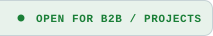</picture>

## 👋 Hi, I'm Damian Chabracki!

<picture><source media="(prefers-color-scheme: dark)" srcset="img/hero/role-dark.svg"></picture>

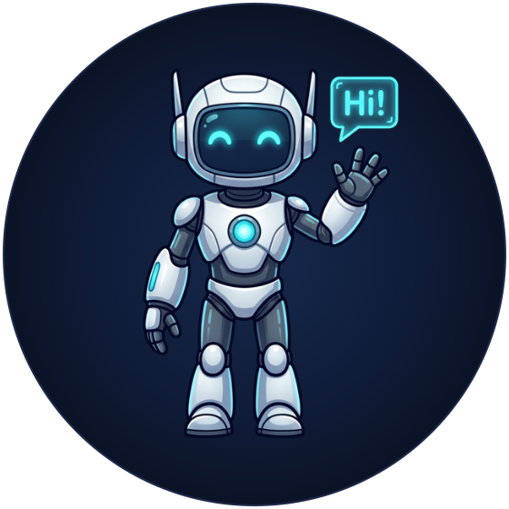

I am a Full-Stack Developer with 4 years of experience building scalable web applications, critical infrastructure dashboards, and multi-tenant B2B platforms. My core expertise lies in the **TypeScript** ecosystem (React, Node.js, NestJS), but my strong academic and practical foundations in **Python**, **C# (OOP)**, and **SQL** allow me to comfortably navigate polyglot environments.

**How I engineer systems:**

- **End-to-End Development:** From gathering requirements and designing database schemas (SQL/NoSQL) to deploying REST/GraphQL APIs and responsive frontends.
- **Architecture & Cloud:** Implementing multi-tenant architectures, micro-services concepts, and deploying containerized applications (Docker, CI/CD).
- **Critical Systems:** Experience in building high-performance, secure SCADA/HMI interfaces for critical infrastructure (NIS2 standards).

📫 **Open to:** Lead Full-Stack and Frontend roles, Tech Lead and Frontend Architect positions, systems architecture consulting and B2B contracts.

 

  <picture><source media="(prefers-color-scheme: dark)" srcset="img/badges/experience-dark.svg"></picture>
  <picture><source media="(prefers-color-scheme: dark)" srcset="img/badges/views-dark.svg"></picture>

 

<picture><source media="(prefers-color-scheme: dark)" srcset="img/hero/heading-public-dark.svg"></picture>

 

<picture><source media="(prefers-color-scheme: dark)" srcset="img/cards/intro-public-dark.svg">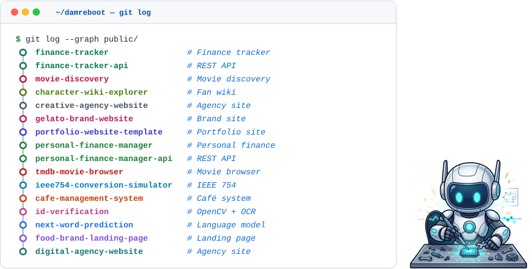</picture>

  <a href="https://github.com/DamTchorzewski/personal-finance-manager"><picture><source media="(prefers-color-scheme: dark)" srcset="img/cards/featured-wallet-dark.svg">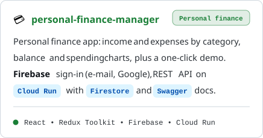</picture></a>
  <a href="https://github.com/DamTchorzewski/personal-finance-manager-api"><picture><source media="(prefers-color-scheme: dark)" srcset="img/cards/featured-pfm-api-dark.svg">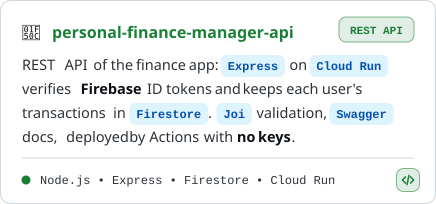</picture></a>

  <a href="https://github.com/DamTchorzewski/tmdb-movie-browser"><picture><source media="(prefers-color-scheme: dark)" srcset="img/cards/featured-tmdb-dark.svg">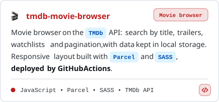</picture></a>
  <a href="https://github.com/DamTchorzewski/ieee754-conversion-simulator"><picture><source media="(prefers-color-scheme: dark)" srcset="img/cards/featured-float64converter-dark.svg">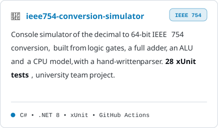</picture></a>

  <a href="https://github.com/DamTchorzewski/cafe-management-system"><picture><source media="(prefers-color-scheme: dark)" srcset="img/cards/featured-cafecontrol-dark.svg">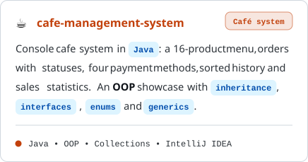</picture></a>
  <a href="https://github.com/DamTchorzewski/id-verification"><picture><source media="(prefers-color-scheme: dark)" srcset="img/cards/featured-id-verification-dark.svg">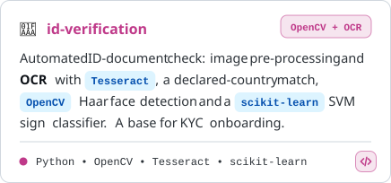</picture></a>

  <a href="https://github.com/DamTchorzewski/next-word-prediction"><picture><source media="(prefers-color-scheme: dark)" srcset="img/cards/featured-next-word-prediction-dark.svg">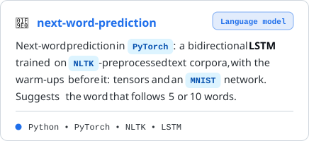</picture></a>
  <a href="https://github.com/DamTchorzewski/food-brand-landing-page"><picture><source media="(prefers-color-scheme: dark)" srcset="img/cards/featured-icecream-dark.svg">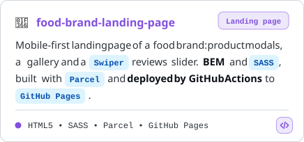</picture></a>

  <a href="https://github.com/DamTchorzewski/digital-agency-website"><picture><source media="(prefers-color-scheme: dark)" srcset="img/cards/featured-webstudio-dark.svg">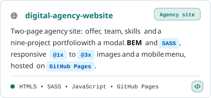</picture></a>

 

<picture><source media="(prefers-color-scheme: dark)" srcset="img/hero/heading-private-dark.svg"></picture>

 

<picture><source media="(prefers-color-scheme: dark)" srcset="img/cards/intro-private-dark.svg">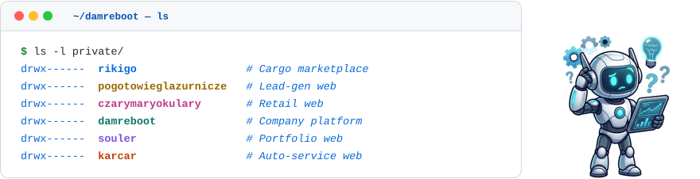</picture>

<picture><source media="(prefers-color-scheme: dark)" srcset="img/cards/row-rikigo-dark.svg"></picture>
<a href="https://pogotowieglazurnicze.pl/"><picture><source media="(prefers-color-scheme: dark)" srcset="img/cards/row-glazurnicze-dark.svg"></picture></a>
<a href="https://czarymaryokulary.pl"><picture><source media="(prefers-color-scheme: dark)" srcset="img/cards/row-czarymary-dark.svg">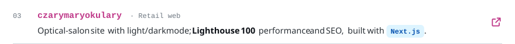</picture></a>
<a href="https://damreboot.pl"><picture><source media="(prefers-color-scheme: dark)" srcset="img/cards/row-damreboot-dark.svg"></picture></a>
<picture><source media="(prefers-color-scheme: dark)" srcset="img/cards/row-souler-dark.svg">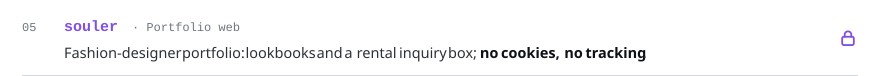</picture>
<picture><source media="(prefers-color-scheme: dark)" srcset="img/cards/row-karcar-dark.svg"></picture>

 

<picture><source media="(prefers-color-scheme: dark)" srcset="img/hero/heading-domains-dark.svg"></picture>

 

<picture><source media="(prefers-color-scheme: dark)" srcset="img/cards/intro-domains-dark.svg">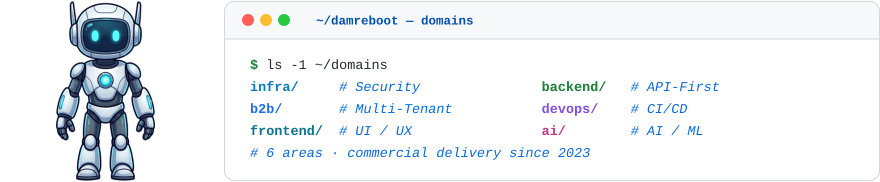</picture>

  <picture><source media="(prefers-color-scheme: dark)" srcset="img/cards/tile-infra-dark.svg">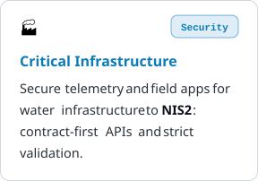</picture>
  <picture><source media="(prefers-color-scheme: dark)" srcset="img/cards/tile-b2b-dark.svg">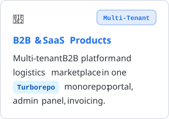</picture>
  <picture><source media="(prefers-color-scheme: dark)" srcset="img/cards/tile-frontend-dark.svg">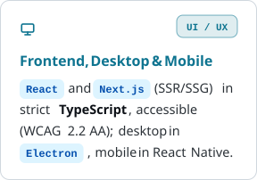</picture>

  <picture><source media="(prefers-color-scheme: dark)" srcset="img/cards/tile-backend-dark.svg">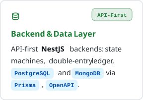</picture>
  <picture><source media="(prefers-color-scheme: dark)" srcset="img/cards/tile-devops-dark.svg">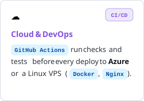</picture>
  <picture><source media="(prefers-color-scheme: dark)" srcset="img/cards/tile-ai-dark.svg">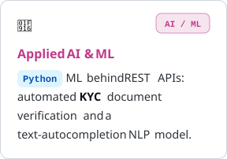</picture>

 

<picture><source media="(prefers-color-scheme: dark)" srcset="img/hero/heading-stack-dark.svg"></picture>

 

<picture><source media="(prefers-color-scheme: dark)" srcset="img/cards/stack-terminal-dark.svg"></picture>

<b>$ npm ls --all</b>: show all languages &amp; tools (46)

 

<picture><source media="(prefers-color-scheme: dark)" srcset="img/cards/tools-terminal-dark.svg">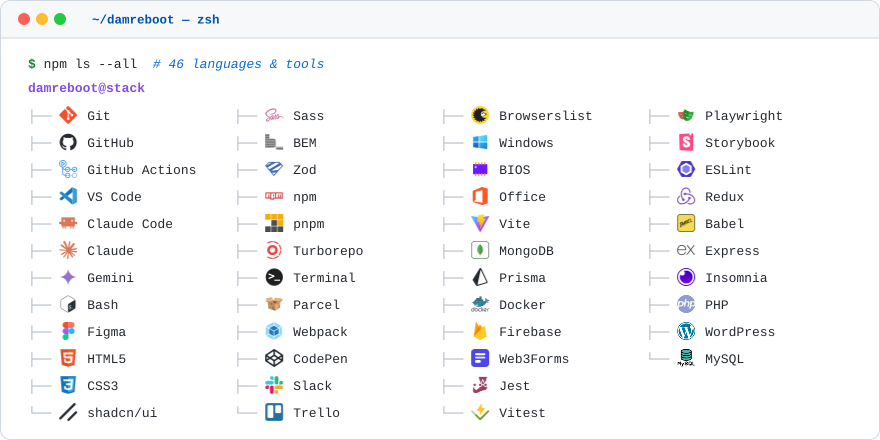</picture>

 

<picture><source media="(prefers-color-scheme: dark)" srcset="img/hero/heading-telemetry-dark.svg"></picture>

 

<picture><source media="(prefers-color-scheme: dark)" srcset="img/cards/intro-telemetry-dark.svg">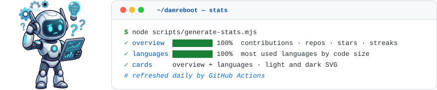</picture>

  <picture>
    <source media="(prefers-color-scheme: dark)" srcset="img/stats/overview-dark.svg">
    <source media="(prefers-color-scheme: light)" srcset="img/stats/overview-light.svg">
    
  </picture>
  <picture>
    <source media="(prefers-color-scheme: dark)" srcset="img/stats/languages-dark.svg">
    <source media="(prefers-color-scheme: light)" srcset="img/stats/languages-light.svg">
    
  </picture>

---

 

<picture><source media="(prefers-color-scheme: dark)" srcset="img/cards/intro-ending-dark.svg"></picture>

<a href="https://damreboot.pl"><picture><source media="(prefers-color-scheme: dark)" srcset="img/badges/company-dark.svg"></picture></a><a href="https://cv.damreboot.pl"><picture><source media="(prefers-color-scheme: dark)" srcset="img/badges/cv-dark.svg"></picture></a><a href="https://www.linkedin.com/in/damian-tchorzewski-3b2388275/"><picture><source media="(prefers-color-scheme: dark)" srcset="img/badges/linkedin-dark.svg"></picture></a><a href="mailto:damianchabracki@gmail.com"><picture><source media="(prefers-color-scheme: dark)" srcset="img/badges/email-dark.svg"></picture></a>

  <picture><source media="(prefers-color-scheme: dark)" srcset="img/icons/engineered-dark.svg"></picture> Engineered by <b>Damian Chabracki</b> (DamReboot IT)

