<picture>
  <source media="(prefers-color-scheme: dark)" srcset="img/damreboot-banner-dark.gif">
  <source media="(prefers-color-scheme: light)" srcset="img/damreboot-banner-light.gif">
  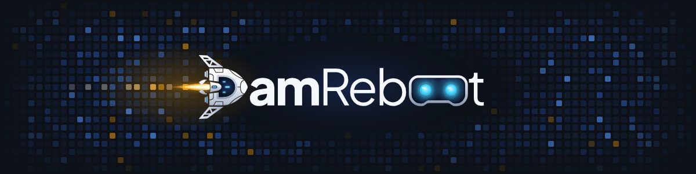
</picture>

# Hi, I'm Damian Chabracki 👋
### Full-Stack Developer | Founder of DamReboot IT

I specialize in building modern, scalable web applications and delivering custom IT solutions. I combine technical expertise with a passion for innovation, creating software that drives results.

**🚀 Quick Facts:**
- 🏢 **Experience:** Working professionally as a Frontend Developer & running my own B2B venture.
- 💻 **Core Stack:** TypeScript, React, Next.js, Node.js, Tailwind CSS.
- 📱 **Cross-platform:** React Native (mobile & tablet) and Electron.js (desktop).
- ☁️ **DevOps & Cloud:** GitHub Actions CI/CD, Turborepo monorepos, Firebase & OVHcloud deployments.
- 🤖 **AI-assisted workflow:** Claude Code CLI, AI agents and Gemini.
- 🌱 **Learning:** C# and advanced database management.
- 🎓 **Education:** Currently pursuing a degree in Computer Science.
- ⚡ **Interests:** Modern tech, complex algorithms, and mechanics.

---

### ⚡ Core stack

<picture>
  <source media="(prefers-color-scheme: dark)" srcset="img/stats/stack-dark.svg">
  <source media="(prefers-color-scheme: light)" srcset="img/stats/stack-light.svg">
  
</picture>

### 📊 GitHub stats

  <picture>
    <source media="(prefers-color-scheme: dark)" srcset="img/stats/overview-dark.svg">
    <source media="(prefers-color-scheme: light)" srcset="img/stats/overview-light.svg">
    
  </picture>
  <picture>
    <source media="(prefers-color-scheme: dark)" srcset="img/stats/languages-dark.svg">
    <source media="(prefers-color-scheme: light)" srcset="img/stats/languages-light.svg">
    
  </picture>

Stats refresh daily via GitHub Actions and include private work as aggregated numbers only.

<b>🧰 All languages &amp; tools (47)</b>

 

  &nbsp;
  &nbsp;
  &nbsp;
  &nbsp;
  &nbsp;
  &nbsp;
  &nbsp;
  &nbsp;
  &nbsp;
  &nbsp;
  &nbsp;
  &nbsp;
  &nbsp;
  &nbsp;
  &nbsp;
  &nbsp;
  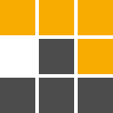&nbsp;
  &nbsp;
  &nbsp;
  &nbsp;
  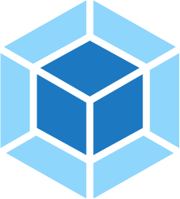&nbsp;
  &nbsp;
  &nbsp;
  &nbsp;
  &nbsp;
  &nbsp;
  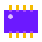&nbsp;
  &nbsp;
  &nbsp;
  &nbsp;
  &nbsp;
  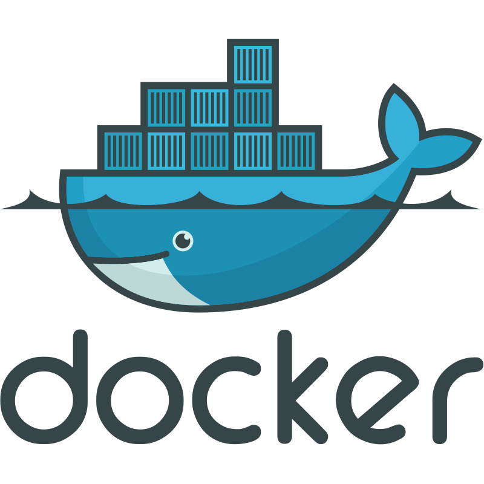&nbsp;
  &nbsp;
  &nbsp;
  &nbsp;
  &nbsp;
  &nbsp;
  &nbsp;
  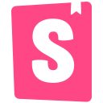&nbsp;
  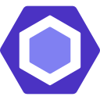&nbsp;
  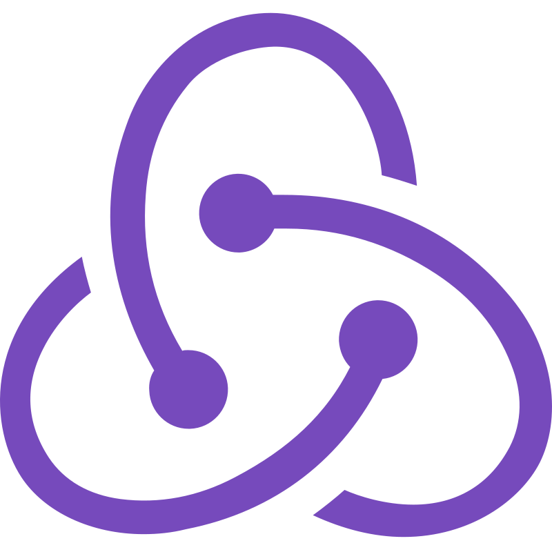&nbsp;
  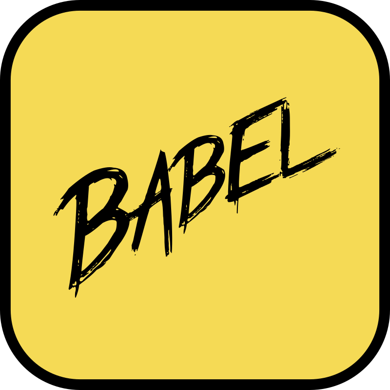&nbsp;
  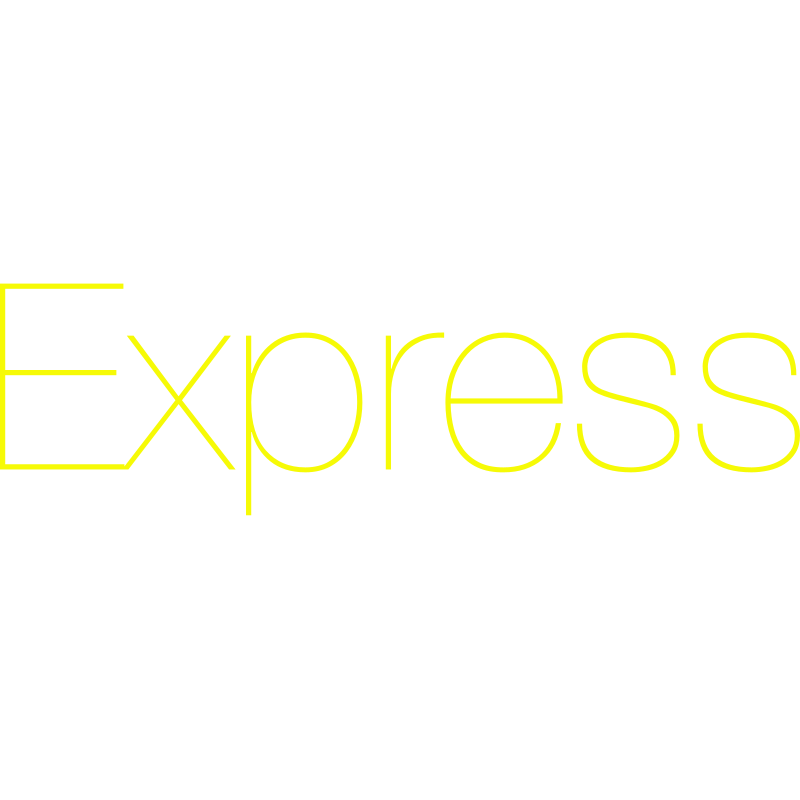&nbsp;
  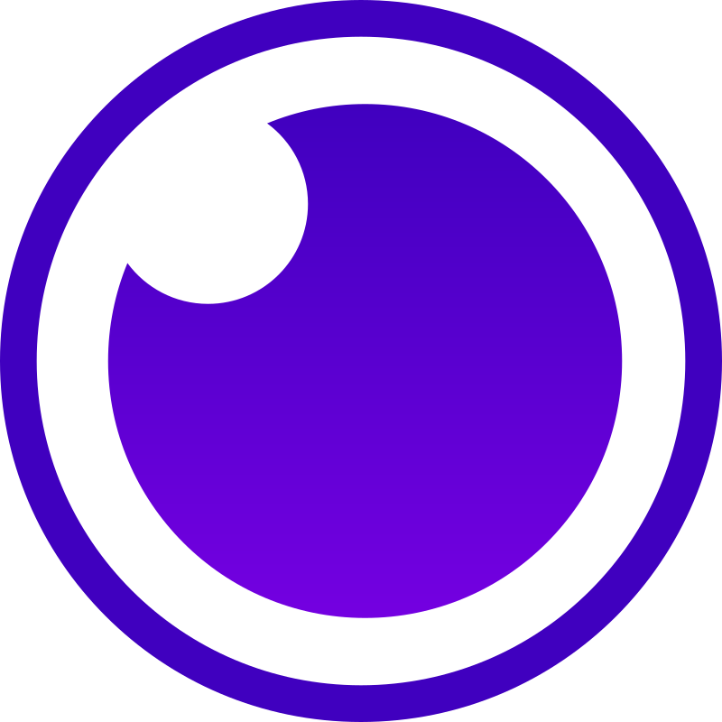&nbsp;
  &nbsp;
  &nbsp;
  &nbsp;

