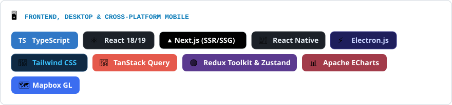
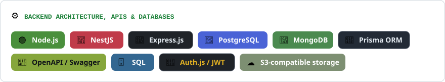
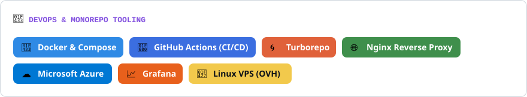
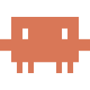
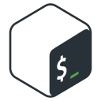
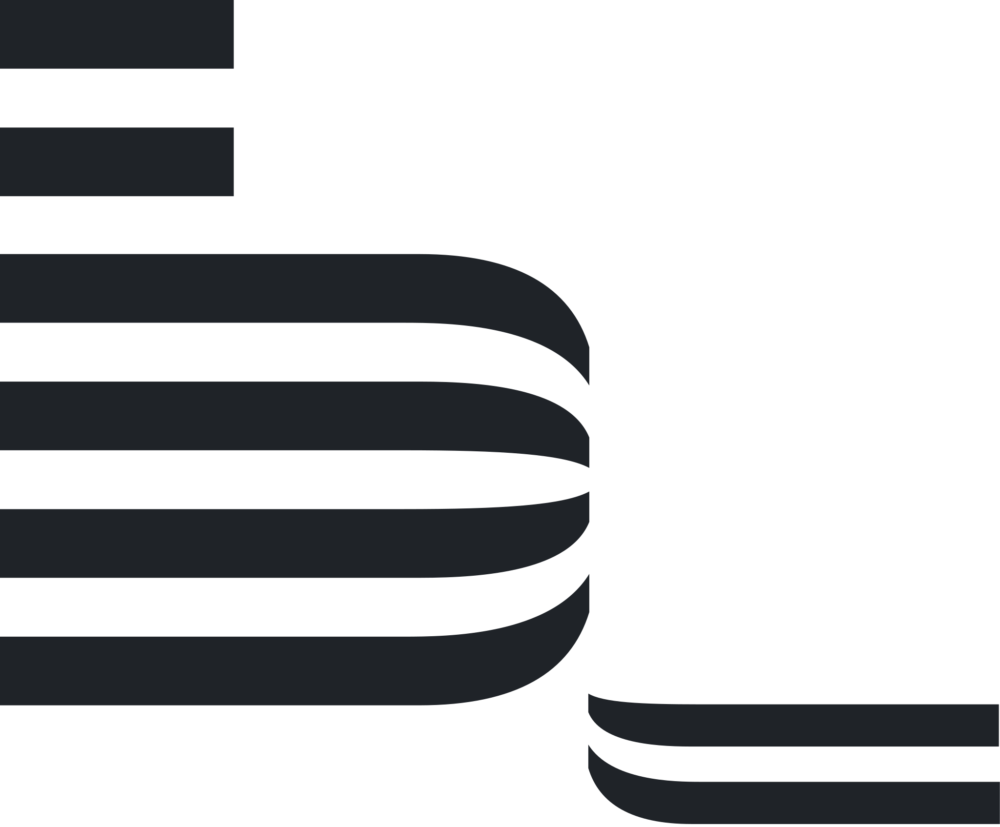
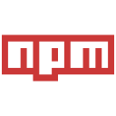

<picture>
  <source media="(prefers-color-scheme: dark)" srcset="img/banner/damreboot-dark.gif">
  <source media="(prefers-color-scheme: light)" srcset="img/banner/damreboot-light.gif">
  
</picture>

<a href="https://damreboot.pl"><picture><source media="(prefers-color-scheme: dark)" srcset="img/badges/company-dark.svg"></picture></a><a href="https://cv.damreboot.pl"><picture><source media="(prefers-color-scheme: dark)" srcset="img/badges/cv-dark.svg"></picture></a><a href="https://www.linkedin.com/in/damian-tchorzewski-3b2388275/"><picture><source media="(prefers-color-scheme: dark)" srcset="img/badges/linkedin-dark.svg"></picture></a><a href="mailto:damianchabracki@gmail.com"><picture><source media="(prefers-color-scheme: dark)" srcset="img/badges/email-dark.svg"></picture></a><picture><source media="(prefers-color-scheme: dark)" srcset="img/badges/status-dark.svg"></picture>

## 🚀 Hi, I'm Damian Chabracki!

<picture><source media="(prefers-color-scheme: dark)" srcset="img/hero/role-dark.svg"></picture>

I architect and deliver **production-grade web, desktop and mobile systems end-to-end**, bridging complex backend engineering and measurable business outcomes. Over the past **4+ years** (commercial since 2023) I have built industrial telemetry platforms, multi-tenant B2B marketplaces and high-conversion commercial websites.

I don't just assemble frameworks. I focus on **how systems behave under the hood**:

- 📐 **Contract-first design:** strict `OpenAPI / Swagger` contracts, end-to-end type safety (`TypeScript`, `Prisma`, `Zod`) and clear module boundaries before any UI code.
- ⚡ **Data & real-time performance:** relational `SQL` schemas, `Grafana` and `ECharts` dashboards, and telemetry UIs that stay fast under large data volumes (code splitting, lazy loading, memoization).
- 🛡️ **Security & reliability:** RBAC authentication (`Auth.js`), **NIS2**-regulated environments, `Jest` tests, WCAG accessibility checks and automated `CI/CD`.
- 📈 **Business-driven engineering:** each choice — a `Turborepo` monorepo for B2B SaaS, static rendering for commercial sites — is judged by scalability, Lighthouse scores, SEO and client results.

 

  <picture><source media="(prefers-color-scheme: dark)" srcset="img/badges/experience-dark.svg"></picture>

## 🧭 Engineering Domains & Production Experience

  <picture><source media="(prefers-color-scheme: dark)" srcset="img/cards/domain-infra-dark.svg"></picture>
  <picture><source media="(prefers-color-scheme: dark)" srcset="img/cards/domain-b2b-dark.svg"></picture>

  <picture><source media="(prefers-color-scheme: dark)" srcset="img/cards/domain-frontend-dark.svg"></picture>
  <picture><source media="(prefers-color-scheme: dark)" srcset="img/cards/domain-backend-dark.svg"></picture>

  <picture><source media="(prefers-color-scheme: dark)" srcset="img/cards/domain-devops-dark.svg"></picture>
  <picture><source media="(prefers-color-scheme: dark)" srcset="img/cards/domain-ai-dark.svg"></picture>

## ⚡ Core Tech Stack & Ecosystem

<picture><source media="(prefers-color-scheme: dark)" srcset="img/cards/stack-frontend-dark.svg"></picture> 
<picture><source media="(prefers-color-scheme: dark)" srcset="img/cards/stack-backend-dark.svg"></picture> 
<picture><source media="(prefers-color-scheme: dark)" srcset="img/cards/stack-devops-dark.svg"></picture> 

## 🚀 Featured Systems & Architecture Highlights

  <picture><source media="(prefers-color-scheme: dark)" srcset="img/cards/featured-rikigo-dark.svg"></picture>
  <picture><source media="(prefers-color-scheme: dark)" srcset="img/cards/featured-wallet-dark.svg"></picture>

  <picture><source media="(prefers-color-scheme: dark)" srcset="img/cards/featured-glazurnicze-dark.svg"></picture>
  <picture><source media="(prefers-color-scheme: dark)" srcset="img/cards/featured-czarymary-dark.svg"></picture>

## 📊 GitHub Telemetry & Language Distribution

  <picture>
    <source media="(prefers-color-scheme: dark)" srcset="img/stats/overview-dark.svg">
    <source media="(prefers-color-scheme: light)" srcset="img/stats/overview-light.svg">
    
  </picture>
  <picture>
    <source media="(prefers-color-scheme: dark)" srcset="img/stats/languages-dark.svg">
    <source media="(prefers-color-scheme: light)" srcset="img/stats/languages-light.svg">
    
  </picture>

<b>Show all languages &amp; tools</b> (47)

 

<!-- tools:start -->
&nbsp;
<picture><source media="(prefers-color-scheme: dark)" srcset="img/tools/github-dark.svg"></picture>&nbsp;
&nbsp;
&nbsp;
&nbsp;
&nbsp;
&nbsp;
&nbsp;
&nbsp;
&nbsp;
&nbsp;
<picture><source media="(prefers-color-scheme: dark)" srcset="img/tools/shadcn-ui-dark.svg"></picture>&nbsp;
&nbsp;
<picture><source media="(prefers-color-scheme: dark)" srcset="img/tools/bem-dark.svg"></picture>&nbsp;
&nbsp;
&nbsp;
&nbsp;
&nbsp;
&nbsp;
&nbsp;
&nbsp;
<picture><source media="(prefers-color-scheme: dark)" srcset="img/tools/codepen-dark.svg"></picture>&nbsp;
&nbsp;
&nbsp;
&nbsp;
&nbsp;
&nbsp;
&nbsp;
&nbsp;
&nbsp;
<picture><source media="(prefers-color-scheme: dark)" srcset="img/tools/prisma-dark.svg"></picture>&nbsp;
&nbsp;
&nbsp;
<picture><source media="(prefers-color-scheme: dark)" srcset="img/tools/ovhcloud-dark.svg"></picture>&nbsp;
&nbsp;
&nbsp;
&nbsp;
&nbsp;
&nbsp;
&nbsp;
&nbsp;
&nbsp;
<picture><source media="(prefers-color-scheme: dark)" srcset="img/tools/express-dark.svg"></picture>&nbsp;
&nbsp;
&nbsp;
&nbsp;

<!-- tools:end -->

---

  ⚡ Engineered by <b>Damian Chabracki</b> (DamReboot IT) · Let's build scalable software together: <a href="https://damreboot.pl">damreboot.pl</a> · <a href="mailto:damianchabracki@gmail.com">damianchabracki@gmail.com</a>

