<picture>
  <source media="(prefers-color-scheme: dark)" srcset="img/banner/damreboot-dark.svg">
  <source media="(prefers-color-scheme: light)" srcset="img/banner/damreboot-light.svg">
  
</picture>

<a href="https://damreboot.pl"><picture><source media="(prefers-color-scheme: dark)" srcset="img/badges/company-dark.svg"></picture></a><a href="https://cv.damreboot.pl"><picture><source media="(prefers-color-scheme: dark)" srcset="img/badges/cv-dark.svg"></picture></a><a href="https://www.linkedin.com/in/damian-tchorzewski-3b2388275/"><picture><source media="(prefers-color-scheme: dark)" srcset="img/badges/linkedin-dark.svg"></picture></a><a href="mailto:damianchabracki@gmail.com"><picture><source media="(prefers-color-scheme: dark)" srcset="img/badges/email-dark.svg"></picture></a><picture><source media="(prefers-color-scheme: dark)" srcset="img/badges/status-dark.svg">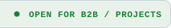</picture>

## 👋 Hi, I'm Damian Chabracki!

<picture><source media="(prefers-color-scheme: dark)" srcset="img/hero/role-dark.svg"></picture>

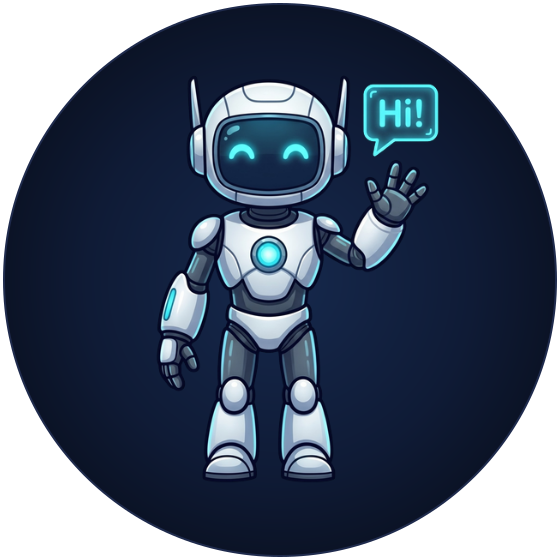

I design, architect and ship production-grade web, mobile and desktop systems. My background spans **mission-critical industrial telemetry (SCADA/HMI)**, **multi-tenant B2B SaaS and marketplaces** and **ML services behind REST APIs**, built from the ground up with strict type safety, predictable state management and measurable business value. Warsaw-based, in commercial delivery since 2023.

**How I engineer systems:**

- **Contract-first architecture:** strict `OpenAPI` / REST schemas, domain boundaries and database models (`PostgreSQL`, `Prisma`) before UI or business logic.
- **Mission-critical reliability:** real-time industrial telemetry systems built to **NIS2** security standards and **WCAG** accessibility.
- **Full-stack TypeScript execution:** high-performance frontends (`Next.js`, `React`, `React Native`, `Electron`) with scalable backend services (`NestJS`, `Node.js`) and `Python` ML.
- **Pragmatic DevOps and ownership:** end-to-end delivery from system design and CI/CD (`Docker`, `GitHub Actions`, `Linux VPS`) to production observability (`Grafana`).

<picture><source media="(prefers-color-scheme: dark)" srcset="img/icons/open-to-dark.svg"></picture> **Open to:** Lead Full-Stack and Frontend roles, Tech Lead and Frontend Architect positions, systems architecture consulting and B2B contracts.

 

  <picture><source media="(prefers-color-scheme: dark)" srcset="img/badges/experience-dark.svg"></picture>

 

<picture><source media="(prefers-color-scheme: dark)" srcset="img/hero/heading-featured-dark.svg"></picture>

 

<picture><source media="(prefers-color-scheme: dark)" srcset="img/cards/intro-featured-dark.svg">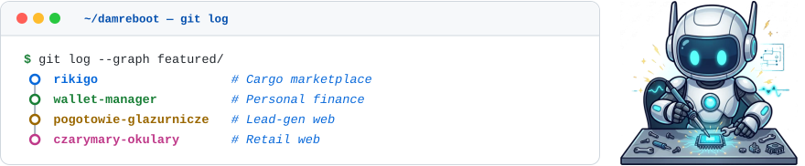</picture>

  <picture><source media="(prefers-color-scheme: dark)" srcset="img/cards/featured-rikigo-dark.svg">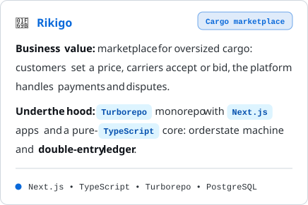</picture>
  <picture><source media="(prefers-color-scheme: dark)" srcset="img/cards/featured-wallet-dark.svg">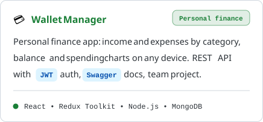</picture>

  <picture><source media="(prefers-color-scheme: dark)" srcset="img/cards/featured-glazurnicze-dark.svg">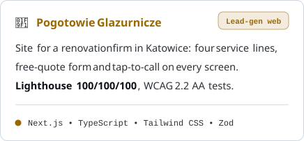</picture>
  <picture><source media="(prefers-color-scheme: dark)" srcset="img/cards/featured-czarymary-dark.svg">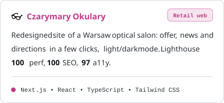</picture>

 

<picture><source media="(prefers-color-scheme: dark)" srcset="img/hero/heading-domains-dark.svg"></picture>

 

<picture><source media="(prefers-color-scheme: dark)" srcset="img/cards/intro-domains-dark.svg">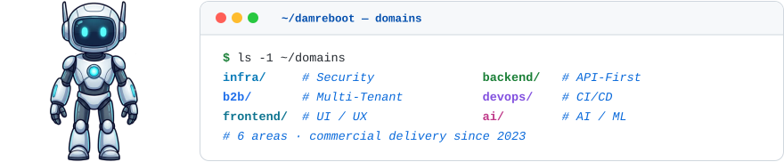</picture>

  <picture><source media="(prefers-color-scheme: dark)" srcset="img/cards/domain-infra-dark.svg">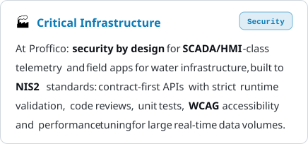</picture>
  <picture><source media="(prefers-color-scheme: dark)" srcset="img/cards/domain-b2b-dark.svg">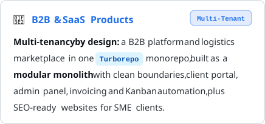</picture>

  <picture><source media="(prefers-color-scheme: dark)" srcset="img/cards/domain-frontend-dark.svg">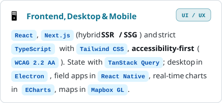</picture>
  <picture><source media="(prefers-color-scheme: dark)" srcset="img/cards/domain-backend-dark.svg">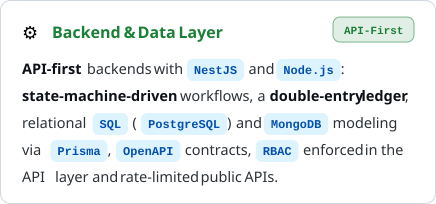</picture>

  <picture><source media="(prefers-color-scheme: dark)" srcset="img/cards/domain-devops-dark.svg">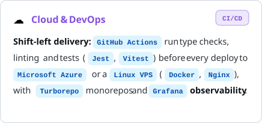</picture>
  <picture><source media="(prefers-color-scheme: dark)" srcset="img/cards/domain-ai-dark.svg">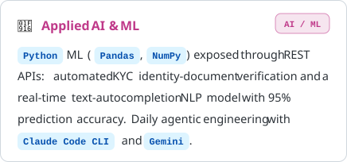</picture>

 

<picture><source media="(prefers-color-scheme: dark)" srcset="img/hero/heading-stack-dark.svg"></picture>

 

<picture><source media="(prefers-color-scheme: dark)" srcset="img/cards/stack-terminal-dark.svg"></picture>

<b>$ npm ls --all</b>: show all languages &amp; tools (46)

 

<picture><source media="(prefers-color-scheme: dark)" srcset="img/cards/tools-terminal-dark.svg">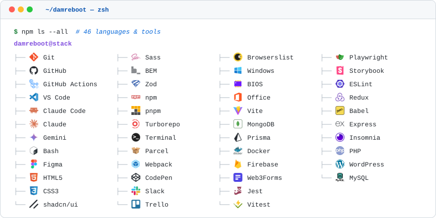</picture>

 

<picture><source media="(prefers-color-scheme: dark)" srcset="img/hero/heading-telemetry-dark.svg"></picture>

 

<picture><source media="(prefers-color-scheme: dark)" srcset="img/cards/intro-telemetry-dark.svg">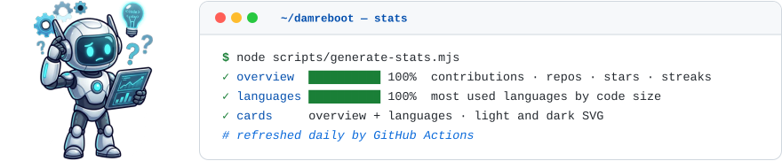</picture>

  <picture>
    <source media="(prefers-color-scheme: dark)" srcset="img/stats/overview-dark.svg">
    <source media="(prefers-color-scheme: light)" srcset="img/stats/overview-light.svg">
    
  </picture>
  <picture>
    <source media="(prefers-color-scheme: dark)" srcset="img/stats/languages-dark.svg">
    <source media="(prefers-color-scheme: light)" srcset="img/stats/languages-light.svg">
    
  </picture>

---

 

<picture><source media="(prefers-color-scheme: dark)" srcset="img/cards/intro-ending-dark.svg"></picture>

<a href="https://damreboot.pl"><picture><source media="(prefers-color-scheme: dark)" srcset="img/badges/company-dark.svg"></picture></a><a href="https://cv.damreboot.pl"><picture><source media="(prefers-color-scheme: dark)" srcset="img/badges/cv-dark.svg"></picture></a><a href="https://www.linkedin.com/in/damian-tchorzewski-3b2388275/"><picture><source media="(prefers-color-scheme: dark)" srcset="img/badges/linkedin-dark.svg"></picture></a><a href="mailto:damianchabracki@gmail.com"><picture><source media="(prefers-color-scheme: dark)" srcset="img/badges/email-dark.svg"></picture></a>

  <picture><source media="(prefers-color-scheme: dark)" srcset="img/icons/engineered-dark.svg"></picture> Engineered by <b>Damian Chabracki</b> (DamReboot IT)

